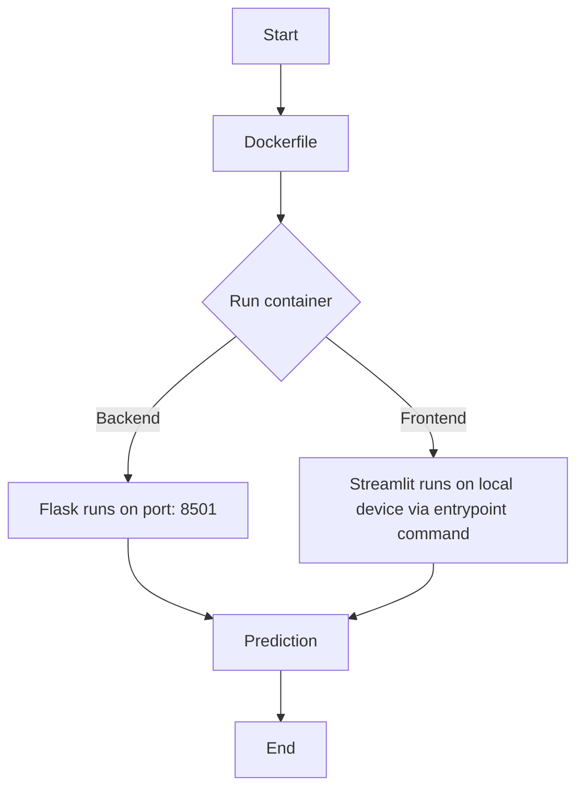

# Task 11: Full Application Containerization

### Objective

To containerize the complete deep learning solution including model, Flask API, and  Streamlit UI.

Deliverables

• Dockerized application.

[Application](https://github.com/persianflower/Deep-Learning/tree/main/LNT_Task_11)

• Architecture diagram.

 
• Testing report.

[Outputs]()
